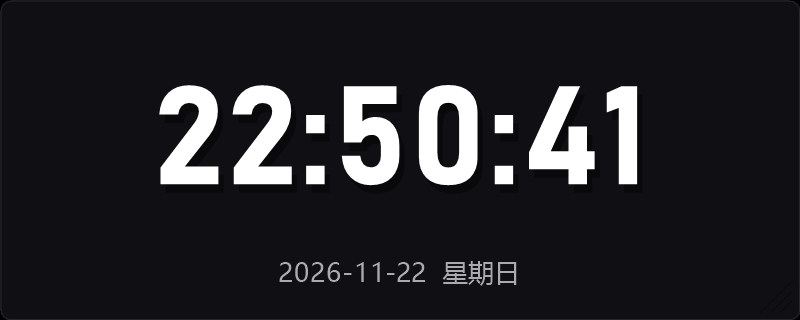
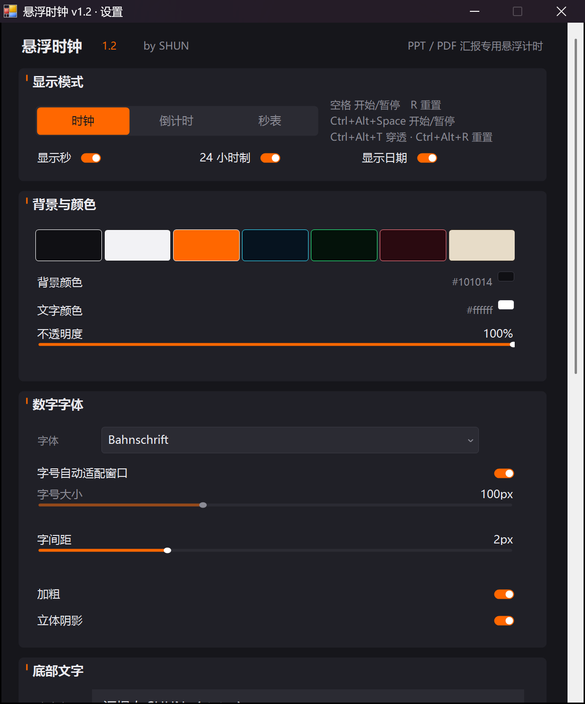

# 悬浮时钟 FloatingClock · v1.2

[](LICENSE)
[](#)
[](#)
[](README_EN.md)

一个常驻桌面最上层的**悬浮时钟 / 倒计时 / 秒表**，专为 PPT、PDF 汇报、演讲、答辩场景设计。
单文件 `.exe`，双击即用，**不需要安装 Python、不需要装 .NET 运行时**（用 Windows 自带的 .NET Framework）。

界面内置**中文 / English 双语切换**，同一份源码可编译出两个语言的版本。

<p align="center">
  
  
</p>

---

## 为什么不用现成的

市面上的汇报计时器普遍有三个毛病：窗口不能自由缩放、配色和字体写死、倒计时只能按分钟粗调。
这个工具的出发点就是把这三点全部放开，再补上汇报现场真正需要的细节：

| 痛点 | 这里的做法 |
| --- | --- |
| 窗口大小固定 | 滚轮缩放、拖右下角自由拉伸、「窗口大小」百分比滑块（40%–400%） |
| 颜色 / 字体改不了 | 7 套预设配色 + 任意十六进制色值；字体下拉框**用字体本身渲染预览** |
| 时长只能整分钟 | 滑块步进 1 秒，再加 `-1s` / `+1s` 按钮逐秒微调 |
| 超时后不知道过了多久 | `00:00` 下方持续显示「已超过 mm:ss」红色加时读数 |
| 一开讲就要手忙脚乱点开始 | 检测 PPT / WPS / Acrobat / 福昕 / Edge 全屏演示，**进入放映自动起表** |
| 计时器挡住翻页 | 点击穿透模式，鼠标事件直接落到 PPT 上 |

---

## 功能

### 三种模式
- **时钟**：12/24 小时制、显示秒、显示日期星期（三个独立开关，冒号每分钟闪烁）
- **倒计时**：底部细进度条；最后 20% 变红；到点闪烁 + 可选响铃；超时后显示加时读数
- **秒表**：`MM:SS.cc` 百分秒精度，用来卡单页讲解时长

### 外观
- 背景色 / 文字色 / 不透明度（35%–100%）
- 字体族、字号（自动适配窗口或 16–260px 手动）、字间距、加粗、立体阴影
- 数字默认按窗口高度 52% 自动缩放，窗口拉多大字就多大，永不溢出
- **底部文字可自定义**，支持 `{date}` `{time}` `{mode}` `{status}` `{over}` 五个占位符；留空则回到自动文案

### 交互
- 无边框、始终置顶、不出现在 Alt-Tab 列表
- 悬停浮出工具条（开始 / 重置 / 设置 / 退出），尺寸随窗口缩放；2 秒无操作自动隐藏
- 右键完整菜单；拖动时靠近屏幕边缘 16px 自动吸附
- 位置、尺寸、配色、字体、语言全部持久化到 `%APPDATA%\FloatingClock\`

### 汇报专用
- **放映自动开始**：
  - PowerPoint / WPS：类名 `screenClass` / `PPTFrameClass` / `wppScreen` / `KWppScreen` / `KWppFrame`，占屏宽 ≥ 90%
  - PDF 全屏：Acrobat、福昕、WPS PDF、Edge / Chrome 浏览器全屏翻页 —— 标题含 `.pdf` 且宽高都 ≥ 90% 屏
- **点击穿透**：时钟只是「贴」在屏幕上，翻页、批注、切窗口完全不受影响
- **默认静音**：到点不响铃（现场突然「叮」一声很尴尬），需要时可开

---

## 快捷键

| 快捷键 | 作用 |
| --- | --- |
| `Ctrl + Alt + Space` | 开始 / 暂停（全局生效） |
| `Ctrl + Alt + R` | 重置当前计时（全局生效） |
| `Ctrl + Alt + T` | 点击穿透开关（全局生效，也是退出穿透的唯一办法） |
| `Space` | 窗口有焦点时开始 / 暂停 |
| `R` | 窗口有焦点时重置 |
| `Esc` | 立刻隐藏顶部工具条 |

---

## 下载与构建

### 直接下载
每次 push 和打 tag 时，GitHub Actions 会自动编译两个版本：

- [Actions](https://github.com/66SHUN66/FloatingClock/actions) 里的 **Artifacts**（每次构建）
- [Releases](https://github.com/66SHUN66/FloatingClock/releases) 里的 exe（打 `v*` tag 时自动发布）

最新版直接点这里：[**v1.2 下载**](https://github.com/66SHUN66/FloatingClock/releases/latest)。详细用法见 [使用说明](docs/usage-zh.md)。

> `FloatingClock.exe` = 英文界面；`FloatingClock-ZH.exe` = 中文界面。两者是同一份源码的两个构建。

### 自己编译
只要 Windows 自带的 `.NET Framework` 编译器，不需要 Visual Studio：

```bat
build\build-zh.bat   :: 中文版 -> dist\FloatingClock-ZH.exe
build\build-en.bat   :: 英文版 -> dist\FloatingClock.exe
build\build.bat      :: 两个都编
```

编译器路径：`C:\Windows\Microsoft.NET\Framework64\v4.0.30319\csc.exe`。

> 图标是可选的：把任意 `.ico` 放到 `assets\app.ico`，构建脚本会自动把它嵌进 exe。

---

## 项目结构

```
FloatingClock/
├── src/
│   ├── FloatingClock.cs    Program / Theme / Config / 右键菜单渲染
│   ├── ClockFormCore.cs    悬浮窗口（上）：字段、计时器、排版与数字绘制
│   ├── ClockFormUi.cs      悬浮窗口（下）：悬浮工具条、右键菜单、模式与几何
│   ├── SettingsForm.cs     设置面板
│   ├── SettingsControls.cs 设置面板的自绘控件（卡片、开关、滑块、色板、分段选择器）
│   ├── FontPicker.cs       字体下拉框 + 弹出列表（每项用字体本身渲染）
│   └── Lang.cs             中英文字符串表（中文原文 -> English）
├── build/                  一键编译脚本
├── assets/                 图标
├── docs/                   界面截图与使用说明
├── dist/                   编译产物（不参与版本管理）
└── .github/workflows/      CI：构建 + 打 tag 发布
```

### 双语是怎么做的
源码里所有界面文字都写成中文，并包在语言表里：

```csharp
AddSwitch(c4, L.S("始终置顶"), cfg.Topmost, ...);
```

`Lang.cs` 保存 `中文 -> English` 的映射，`L.En` 决定取哪一边；`/define:EN` 只改变「默认语言」，用户仍可在设置页顶部随时切换。

---

## 配置文件

`%APPDATA%\FloatingClock\config.ini`（中文版）与 `config-en.ini`（英文版）—— 两个版本各用各的，同时运行互不干扰。

```ini
mode=clock            # clock / countdown / stopwatch
x=.. y=.. w=.. h=..   # 窗口位置与尺寸（逻辑像素，96dpi 基准）
bg=#101014            # 背景色
fg=#ffffff            # 文字色
alpha=0.95            # 不透明度
font=Bahnschrift      # 字体族
bold=1 autofit=1 fontpx=100 spacing=2 shadow=1
showseconds=1 hour24=1 showdate=1
topmost=1 locked=0 clickthrough=0 pptauto=1
countdownsecs=300 beep=0 warnred=1 flashcolon=1
caption=              # 底部文字，留空 = 自动
lang=zh               # zh / en
```

删掉这个文件即可恢复出厂设置；崩溃日志写在同目录的 `error.log`。

---

## 版本历史

| 版本 | 内容 |
| --- | --- |
| **v1.0** | 时钟 / 倒计时 / 秒表、自由缩放、配色与字体、点击穿透、全局热键 |
| **v1.1** | 版本号与作者署名、倒计时 1 秒精度 + `±1s`、超时读数、默认静音、工具条随窗缩放、窗口大小滑块、快捷键表移到模式切换器右侧 |
| **v1.2** | 设置页可最小化、PDF 全屏演示自动开始计时、底部文字自定义（5 个占位符）、设置页内中英切换 |

---

## 许可

[MIT](LICENSE) © 2026 SHUN
