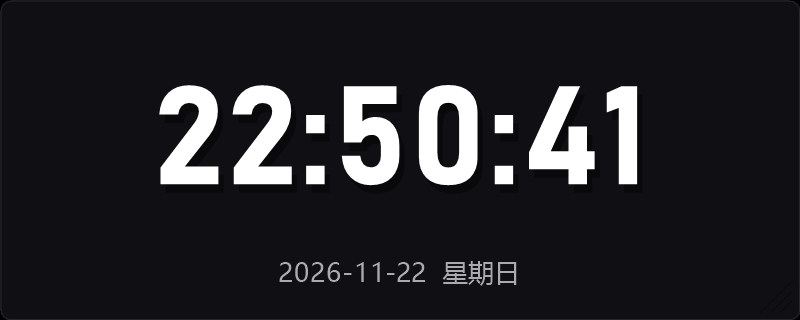
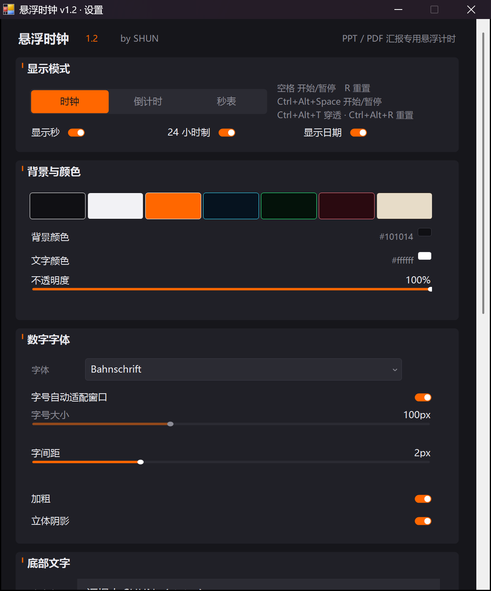

# FloatingClock · v1.2

[](LICENSE)
[](#)
[](#)
[](README.md)

A borderless, always-on-top **clock / countdown / stopwatch overlay**, built for talks, defence sessions and any presentation where you cannot afford to look at your watch.

One self-contained `.exe` compiled with the C# compiler that ships inside Windows — **no Python, no .NET runtime to install**.

The UI is bilingual: the same source tree builds a Chinese and an English edition.

<p align="center">
  
  
</p>

---

## Why not an off-the-shelf timer

Most presentation timers are rigid: fixed window size, fixed colours, countdown only in whole minutes. This one opens all three up and adds the details a live talk actually needs.

| Annoyance | What this does instead |
| --- | --- |
| Fixed window size | Mouse-wheel scaling, corner drag, and a 40–400 % size slider |
| Colours and fonts locked | 7 palettes + any hex colour; font list renders every entry in its own typeface |
| Countdown in whole minutes | 1-second slider steps plus `-1s` / `+1s` buttons |
| No idea how far over you are | A red "overtime mm:ss" read-out stays under `00:00` |
| Fumbling to start when the talk begins | Detects PPT / WPS / Acrobat / Foxit / Edge full-screen playback and starts by itself |
| Overlay eats your clicks | Click-through mode passes every click to the slides |

---

## Features

**Three modes**
- Clock: 12/24-hour, seconds, date + weekday, blinking colon
- Countdown: slim progress bar, red in the last 20 %, flashing + optional beep at zero, overtime read-out
- Stopwatch: `MM:SS.cc`, handy for timing a single slide

**Look**
- Background / text colour, opacity 35–100 %
- Font family, size (auto-fit to window or 16–260 px), letter spacing, bold, drop shadow
- Digits auto-scale to ~52 % of the window height, so they never overflow at any size
- **Custom footer text** with `{date}` `{time}` `{mode}` `{status}` `{over}` placeholders; empty = automatic caption

**Interaction**
- Borderless, always on top, hidden from Alt-Tab
- Hover toolbar (start / reset / settings / quit) that scales with the window
- Full right-click menu, 16 px screen-edge snapping
- Position, size, colours, font and language are persisted under `%APPDATA%\FloatingClock\`

**Made for presenting**
- **Auto-start on playback**: PowerPoint / WPS slideshows (window classes `screenClass`, `PPTFrameClass`, `wppScreen`, `KWppScreen`, `KWppFrame`, ≥ 90 % screen width) and full-screen PDF playback (Acrobat, Foxit, WPS PDF, Edge / Chrome — window title contains `.pdf` and covers ≥ 90 % of the screen in both directions)
- **Click-through** so the overlay never blocks paging or annotation
- **Silent by default**: no beep at zero unless you enable it

---

## Hotkeys

| Hotkey | Action |
| --- | --- |
| `Ctrl + Alt + Space` | Start / pause (global) |
| `Ctrl + Alt + R` | Reset the current timer (global) |
| `Ctrl + Alt + T` | Toggle click-through (global, also the only way out of it) |
| `Space` | Start / pause when the window has focus |
| `R` | Reset when the window has focus |
| `Esc` | Hide the floating toolbar |

---

## Download & build

**Download**: every push is compiled by GitHub Actions — grab the binaries from [Actions](https://github.com/66SHUN66/FloatingClock/actions) artifacts, or from [Releases](https://github.com/66SHUN66/FloatingClock/releases) (published on `v*` tags).

`FloatingClock.exe` is the English edition, `FloatingClock-ZH.exe` the Chinese one — same source, two builds.

Latest build: [**v1.2 release**](https://github.com/66SHUN66/FloatingClock/releases/latest). The Chinese user guide lives in [docs/usage-zh.md](docs/usage-zh.md).

**Build it yourself** — only the .NET Framework compiler bundled with Windows is needed, no Visual Studio:

```bat
build\build-zh.bat   :: Chinese edition -> dist\FloatingClock-ZH.exe
build\build-en.bat   :: English edition -> dist\FloatingClock.exe
build\build.bat      :: both
```

Compiler: `C:\Windows\Microsoft.NET\Framework64\v4.0.30319\csc.exe`.

> The icon is optional: drop any `.ico` at `assets\app.ico` and the build scripts embed it.

---

## Layout

```
FloatingClock/
├── src/
│   ├── FloatingClock.cs    Program / Theme / Config / context-menu renderer
│   ├── ClockFormCore.cs    overlay, part 1: fields, timer, layout maths, digit painting
│   ├── ClockFormUi.cs      overlay, part 2: hover toolbar, menus, modes, geometry
│   ├── SettingsForm.cs     settings dialog
│   ├── SettingsControls.cs custom-drawn widgets (card, switch, slider, colour row, segment)
│   ├── FontPicker.cs       font drop-down with per-font preview
│   └── Lang.cs             Chinese → English string table
├── build/                  one-click build scripts
├── assets/                 app icon
├── docs/                   screenshots and the Chinese user guide
├── dist/                   build output (git-ignored)
└── .github/workflows/      CI: build + release on tag
```

### How the bilingual UI works

Every user-visible string is written in Chinese in the source and wrapped in the language table:

```csharp
AddSwitch(c4, L.S("始终置顶"), cfg.Topmost, ...);
```

`Lang.cs` holds the `Chinese -> English` map, `L.En` picks the side. `/define:EN` only changes the *default* language; the user can still flip it at the top of the settings dialog.

---

## Config

`%APPDATA%\FloatingClock\config.ini` (Chinese build) and `config-en.ini` (English build) — separate files, so both editions can run side by side without fighting over language or geometry.

```ini
mode=clock            # clock / countdown / stopwatch
x=.. y=.. w=.. h=..   # logical pixels at 96 dpi
bg=#101014  fg=#ffffff  alpha=0.95
font=Bahnschrift  bold=1 autofit=1 fontpx=100 spacing=2 shadow=1
showseconds=1 hour24=1 showdate=1
topmost=1 locked=0 clickthrough=0 pptauto=1
countdownsecs=300 beep=0 warnred=1 flashcolon=1
caption=              # footer text, empty = automatic
lang=zh               # zh / en
```

Delete the file to restore factory settings; crashes are logged to `error.log` next to it.

---

## Changelog

| Version | Highlights |
| --- | --- |
| **v1.0** | Clock / countdown / stopwatch, free scaling, colours & fonts, click-through, global hotkeys |
| **v1.1** | Version + author stamp, 1-second countdown precision with ±1s nudge, overtime read-out, silent by default, toolbar scales with the window, window-size slider, shortcut sheet moved next to the mode switch |
| **v1.2** | Settings window can be minimised, auto-start on full-screen PDF playback, custom footer text with 5 placeholders, in-app Chinese/English switch |

---

## License

[MIT](LICENSE) © 2026 SHUN
